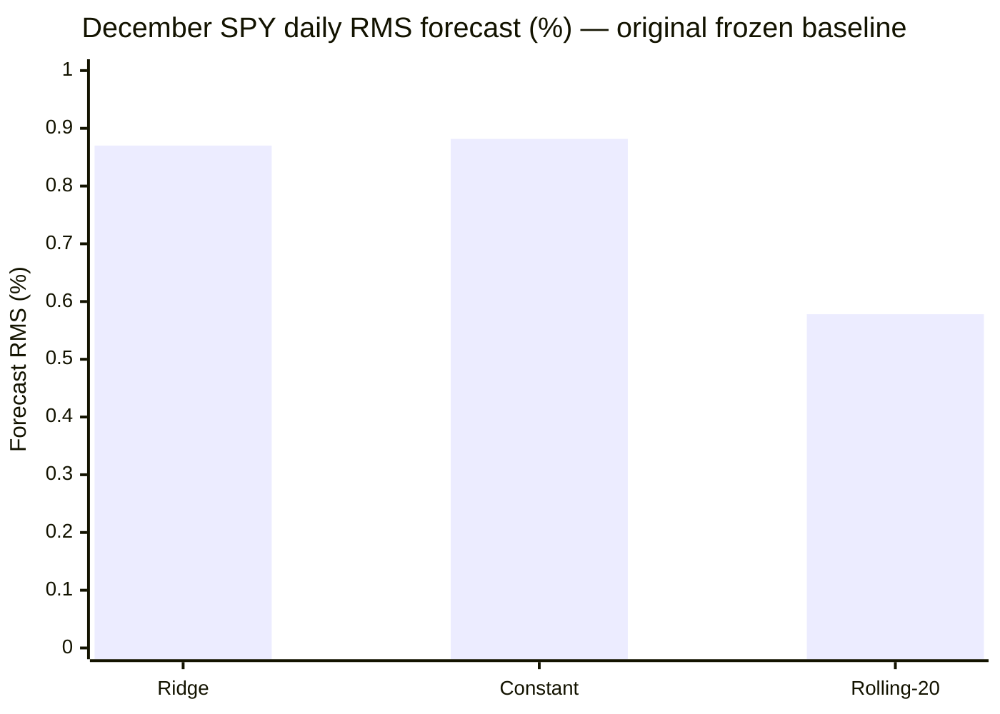
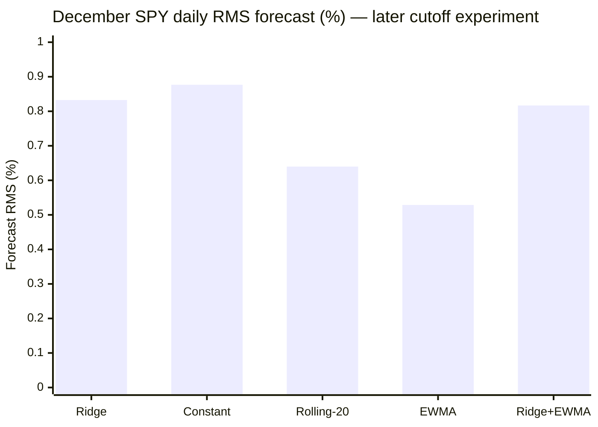
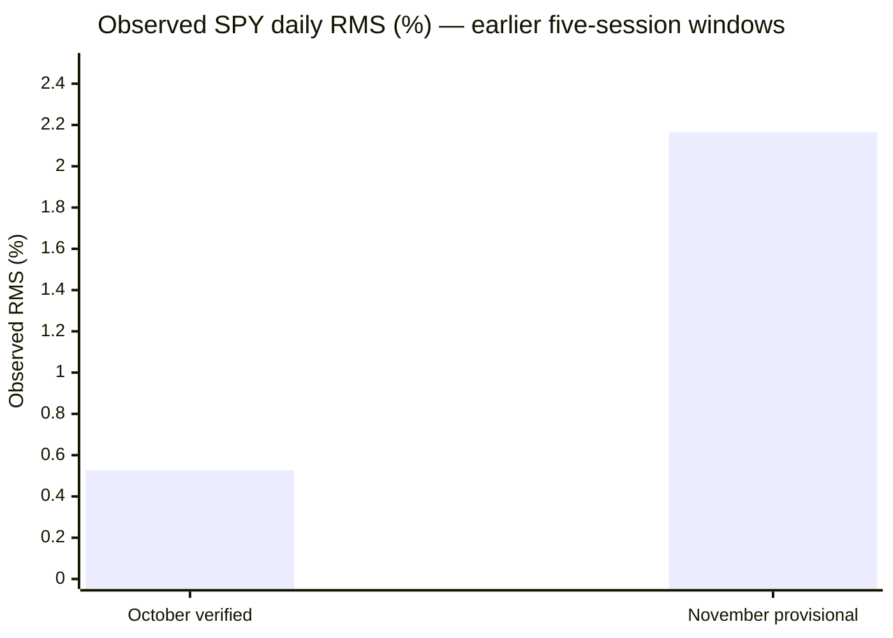

# December 2026 — SPY risk forecast | At a glance

> **Research outcome:** I published December forecasts **before the target period**. The forecasts are **frozen**, not yet scored. In the two earlier evaluation windows, October was more accurate than November; November's source reconciliation is still provisional.

| What a reader should know | Result |
|---|---|
| **What I predict** | How large SPY's daily movements may be across five trading sessions |
| **Forecast window** | December 1–7, 2026 (five sessions) |
| **Forecast status** | **Already published and preserved — no retraining** |
| **Accuracy status** | **Pending** until December 7 market close and source verification |
| **What worked previously?** | October: Rolling-20 closest; November: Constant closest (provisional) |
| **Biggest limitation** | November Yahoo full-precision reconciliation and USO data remain incomplete |

## Visual 1 — December forecasts already on record

The bars show predicted **daily RMS (%)**, not predicted returns or investment gains. The two sets use **different historical information cutoffs**, so I keep them separate.

### Original baseline · August 31 information cutoff

### Separate EWMA experiment · October 7 information cutoff

**How to read these:** The forecast values are estimates of typical *daily move magnitude* over the five-session window. A lower bar is **not automatically a better model**. We cannot determine which forecast is most accurate until the December outcome is measured.

## Visual 2 — Why I am cautious about the results

**What happened?** November's observed daily movements were about **4.11 times** October's. All three original models were closer in October than in November. The November figure is computed from Yahoo-displayed adjusted closes rounded to cents, **not** a completed full-precision Yahoo reconciliation.

## Research status in one glance

| Stage | Status | What it means |
|---|---|---|
| October evaluation | **Completed** | Full-precision Yahoo SPY reconciliation archived |
| November SPY evaluation | **Provisional** | Rounded adjusted closes; full-precision source still missing |
| November eight-ETF evaluation | **Incomplete** | USO's six-price series not verified |
| December predictions | **Frozen** | Original archive values preserved; no changes to models |
| December evaluation | **Not started** | December 1–7 outcomes are in the future |

**Why November remains provisional as of November 21, 2026:** Yahoo Finance source retrieval did not provide the full-precision November adjusted-close snapshot needed to match October's verification standard, and the complete USO series was not verified. This is a **data-access and provenance gap**, not evidence that November prices have not been published. I have not substituted estimated data or revised any forecast to improve its score.

**Explore the evidence:** [Original frozen forecast CSV](../forecasts/2026-09-30-v0.1/forecasts.csv) · [October-cutoff forecast CSV](../forecasts/2026-10-08-ewma-october/forecasts.csv) · [October evaluation](october_2026_baseline_evaluation.md) · [November provisional evaluation](november_2026_evaluation.md)

---

# Methods, limitations and full documentation

## What am I predicting?
I forecast the root-mean-square (RMS) of five daily SPY log returns for **December 1–7, 2026** (trading sessions December 1, 2, 3, 4 and 7). The return anchor is November 30. This measures daily movement size, not return direction, profitability, or the entire month's volatility.

## Why am I publishing this now?
I want a clear, dated record before the December target starts. I discovered that **December predictions already exist in the original frozen archives**. I am **not fitting new models or replacing any forecast**. This note makes the pre-existing predictions easier to find and compare after the target ends.

## How did I make these forecasts?
The original three-model release uses information through **August 31, 2026**. A separate five-model EWMA experiment uses information through **October 7, 2026**. The methods and precise archived values are in the linked CSVs. The target is sqrt(mean of the five squared daily log returns), without subtracting the mean or annualizing.

### Original August 31 cutoff (three baseline models)
| Model | Predicted December daily RMS |
|---|---:|
| Ridge | 0.8701% |
| Constant | 0.8817% |
| Rolling-20 RMS | 0.5780% |

Source: [original frozen forecast archive](../forecasts/2026-09-30-v0.1/forecasts.csv). The percentages above are rounded for readability; the CSV retains full precision.

### Separate October 7 cutoff (five models)
| Model | Predicted December daily RMS |
|---|---:|
| Ridge | 0.8325% |
| Constant | 0.8767% |
| Rolling-20 RMS | 0.6398% |
| Standalone EWMA | 0.5287% |
| Ridge + EWMA | 0.8169% |

Source: [October 8 EWMA forecast archive](../forecasts/2026-10-08-ewma-october/forecasts.csv). This is a separate experiment, not a revision of the original release.

## What happened in October and November?
In October, the observed SPY daily RMS was about **0.5263%**, and the original Rolling-20 forecast was closest. For November 2–6, the **provisional** observed SPY RMS from cent-rounded Yahoo Finance displayed adjusted closes is about **2.1650%**, and the constant baseline was closest. October's forecasts were more accurate in these two windows. This does not establish a universally best model.

## Why is November not fully verified as of November 21, 2026?
The November trading window has **already finished**. The outstanding issue is **data access and reproducibility, not waiting for November prices to be published**. During the November evaluation, I could check Yahoo Finance historical adjusted-close values **rounded to cents** for SPY and six other ETFs. I could not archive a full-precision Yahoo Finance chart-API response for November, and I could not retrieve a complete six-date adjusted-close series for **USO**, the eighth ETF. I therefore cannot claim a full-precision, eight-ETF November reconciliation. I have not filled the missing data with guesses. Local numerical checks do not substitute for original provider-data verification.

This limitation does **not** invalidate the pre-existing December forecasts: they were recorded before December's target window and can be evaluated later independently of November's unfinished source reconciliation. It does mean that the November evaluation should continue to be labeled provisional.

## What are the limitations and next steps?
The December predictions are point estimates, not guarantees. The August and October information cutoffs must not be mixed into one experiment. The original archives must remain unchanged. After the **December 7 US market close**, I will need adjusted closing prices for November 30 and all five December target dates, verified against the source, to compute observed RMS and absolute forecast errors. I should preserve source snapshots, timestamps, checksums and any access limitations, and compare the two forecast vintages separately.

## Sources and reproducibility
- [Original forecast protocol](forecast_freeze_v0_1.md)
- [Original August-cutoff CSV](../forecasts/2026-09-30-v0.1/forecasts.csv)
- [October-cutoff EWMA CSV](../forecasts/2026-10-08-ewma-october/forecasts.csv)
- [EWMA freeze methodology](ewma_freeze_2026-10-08.md)
- [October evaluation](october_2026_baseline_evaluation.md)
- [Provisional November evaluation](november_2026_evaluation.md)
- [Yahoo Finance SPY historical data](https://finance.yahoo.com/quote/SPY/history/)
- [Yahoo Finance USO historical data](https://finance.yahoo.com/quote/USO/history/)

**Research integrity:** This publication documents already archived December forecasts. It does not change the forecasts, claim December outcomes, or claim November's missing full-precision source verification is complete.
