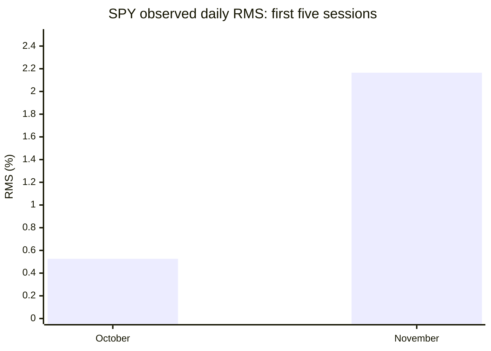
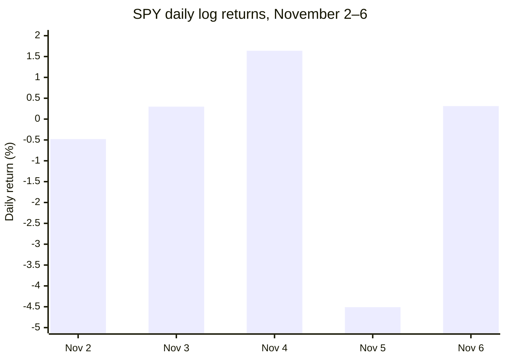
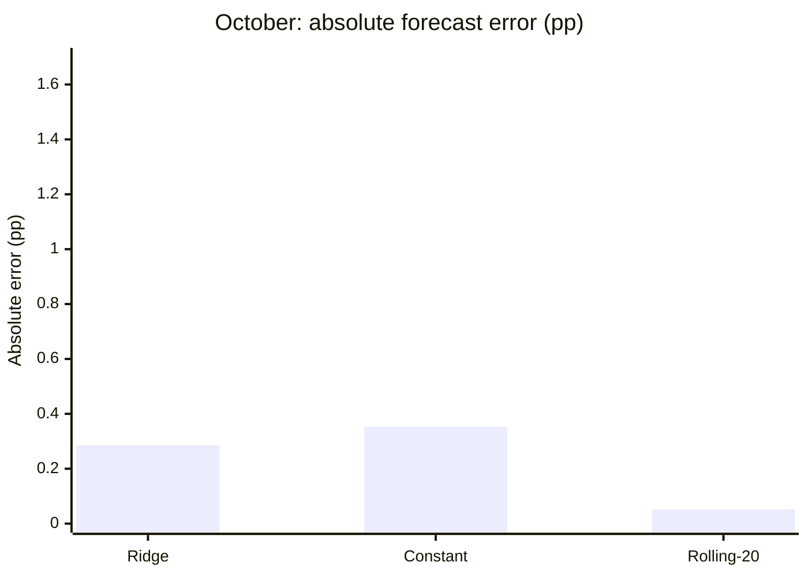
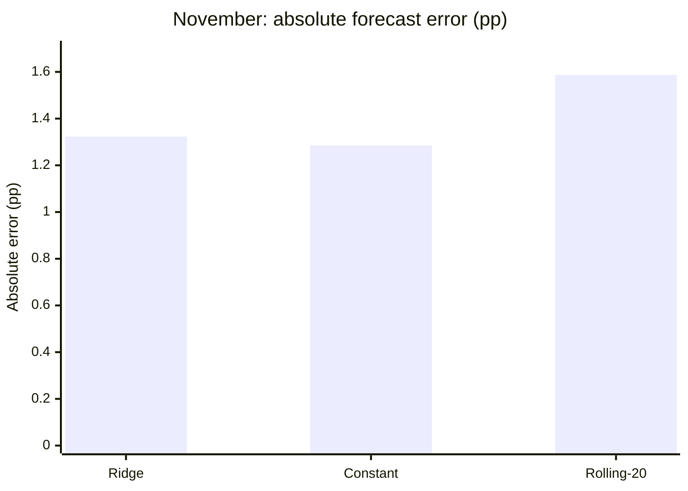

# My November 2026 SPY evaluation — provisional

## At a glance: what did I find?

| Measure | October | November |
|---|---:|---:|
| Observed five-session daily RMS | **0.5263%** | **2.1650%** |
| Closest original model | Rolling-20 | Constant |
| Smallest absolute forecast error | **0.0517 pp** | **1.2853 pp** |
| Data verification | Archived full-precision Yahoo reconciliation | Yahoo-displayed prices rounded to cents |

I found that **October was more accurate for all three original models**. November's observed RMS was about **4.11 times** October's. A higher RMS means larger daily movements; it does not tell me whether an investment was profitable.

### Chart 1 — Observed RMS (%)

### Chart 2 — November's five daily log returns (%)

November 5 accounted for about **86.8% of the sum of squared returns** in this five-day window. That explains the high RMS; it does not mean I could have predicted the move.

### Chart 3 — How much did the original models miss by?

The bars below show **absolute forecast error in percentage points**. Lower is better. All three models use the same August 31 information cutoff.

I use the **same vertical scale** for these two charts so the difference is easier to see.

### Chart 4 — Did using the later information cutoff help in November?

These are **separate forecast experiments**, not replacements for my original August-cutoff forecasts.

| Model | Aug 31 cutoff absolute error | Oct 7 cutoff absolute error |
|---|---:|---:|
| Ridge | 1.3232 pp | 1.3770 pp |
| Constant | **1.2853 pp** | **1.2884 pp** |
| Rolling-20 | 1.5870 pp | 1.5252 pp |
| EWMA | 1.7331 pp | 1.6362 pp |
| Ridge + EWMA | 1.3260 pp | 1.4219 pp |

The later cutoff improved Rolling-20 and EWMA, but it did not improve every method. Constant remained closest in both sets.

---

## What did I test?
I checked how well my previously frozen models predicted the daily log-return RMS of SPY during the first five trading sessions of November 2026: November 2, 3, 4, 5 and 6. I used October 30 as the price anchor. My target is **one RMS value from five daily returns**, not five independent forecasts, a monthly return, or annualized volatility.

## Why did I do this?
I wanted to repeat my October evaluation without changing the predictions after seeing the outcome. I also wanted to find out whether the method that was closest in October remained closest in November.

## How did I calculate it?
I used the six saved adjusted closing prices in [the November input file](../results/november_2026/adjusted_close.csv). For each day, I calculated r_t = ln(A_t / A_(t-1)), then RMS = sqrt((r_1^2 + ... + r_5^2)/5). I did **not** subtract the average return or annualize the result.

The saved adjusted prices (USD) are: October 30 **755.72**, November 2 **752.10**, November 3 **754.35**, November 4 **766.81**, November 5 **733.00**, and November 6 **735.29**. The resulting daily log returns are in [daily_log_returns.csv](../results/november_2026/daily_log_returns.csv).

My observed November RMS is **2.1649520304%** (about **2.1650%**). The November 5 return, about **-4.51%**, had a large effect because RMS squares the returns.

I scored the original August 31 forecasts from [the frozen September 30 archive](../forecasts/2026-09-30-v0.1/forecasts.csv). I did not refit the models. I kept the later October 7 cutoff experiments separate; they are not the same information set as the original baseline.

## What happened? Original three-model comparison

| Model | November forecast RMS | November absolute error |
|---|---:|---:|
| Ridge | 0.8418% | 1.3232 percentage points |
| Constant | 0.8797% | **1.2853 percentage points** |
| Rolling-20 RMS | 0.5780% | 1.5870 percentage points |

All three original forecasts **underestimated** November RMS. The **constant** baseline was closest in November, although its error was still large.

## Was October or November better?
October was better **for forecast accuracy**. The original October Yahoo reconciliation found an observed RMS of **0.5262540681%**, and rolling-20 was closest. The original three-model absolute errors were approximately **0.2855** (Ridge), **0.3529** (Constant), and **0.0517** (Rolling-20) percentage points. In November, all three errors were larger. The smallest error rose from about **0.0517** to **1.2853** percentage points.

The observed November RMS was about **4.11 times** October's. This compares the size of daily price movements, **not** investment returns or trading profitability.

## What about the October 7 updated experiments?
I checked these separately because their information cutoff differs from the original August 31 forecasts. The October 7 November forecasts were: Ridge **0.7879%**, Constant **0.8766%**, Rolling-20 **0.6398%**, EWMA **0.5287%**, and Ridge + EWMA **0.7430%**. The constant baseline was also closest in this set, with an absolute error of about **1.2884 percentage points**. I do not mix this ranking with the original three-model October comparison.

The additional August-cutoff EWMA and Ridge + EWMA November forecasts were **0.4319%** and **0.8389%**. Neither beat the constant baseline in November. These are separate experiments, not part of the original three-method October baseline evaluation.

## What are my limitations?
**This is a provisional, rounded-price evaluation.** My November prices were taken from a previously prepared snapshot of the **Yahoo Finance historical webpage's displayed adjusted closes**, which show cents. I could not obtain and archive Yahoo's **full-precision November chart-API adjusted closes** in this run. Therefore, I cannot call this a full-precision Yahoo reconciliation or claim that I independently verified a raw provider response.

My October repository includes additional work that I have **not yet repeated for November**: a complete eight-ETF observed profile, the original multi-panel image figures, input/provenance SHA-256 verification, and dedicated repository tests. I have not represented those checks as completed.

Two five-session windows cannot establish which model is best over time. The large November error does not prove that the movement was predictable from the earlier information cutoffs.

## Where did the data and forecasts come from?
- **November displayed adjusted closing prices:** [Yahoo Finance, SPY historical data](https://finance.yahoo.com/quote/SPY/history/). This is a rounded historical-page snapshot, not a saved full-precision API response.
- **Original full-precision provider method used in October:** [Yahoo Finance chart API](https://query1.finance.yahoo.com/v8/finance/chart/SPY), documented in [my October evaluation](october_2026_baseline_evaluation.md) and [October Yahoo reconciliation](../results/october_2026_yahoo_reconciliation/summary.json).
- **Frozen original forecasts:** [September 30 archive](../forecasts/2026-09-30-v0.1/forecasts.csv).
- **Separate later experiments:** [October 8 August-cutoff EWMA archive](../forecasts/2026-10-08-ewma-august-original-verified/forecasts.csv) and [October 8 October-cutoff archive](../forecasts/2026-10-08-ewma-october/forecasts.csv).

## My conclusion
**October was more accurate.** Rolling-20 was close in October, but none of my models anticipated the much larger November RMS. This is a useful negative result. I am keeping my original predictions unchanged and clearly marking the November source and verification limits until I can complete the full-precision reconciliation.
